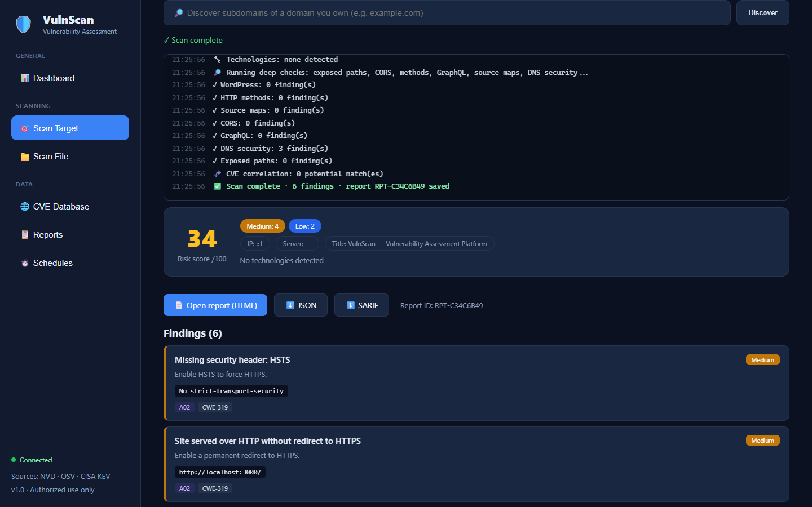
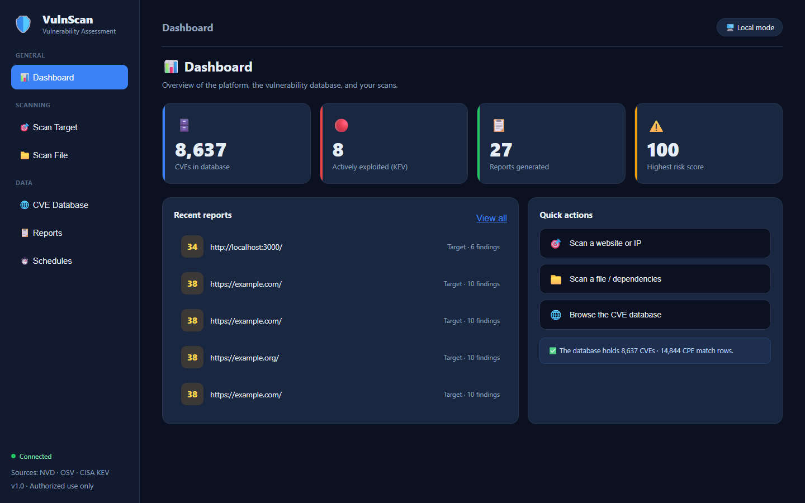
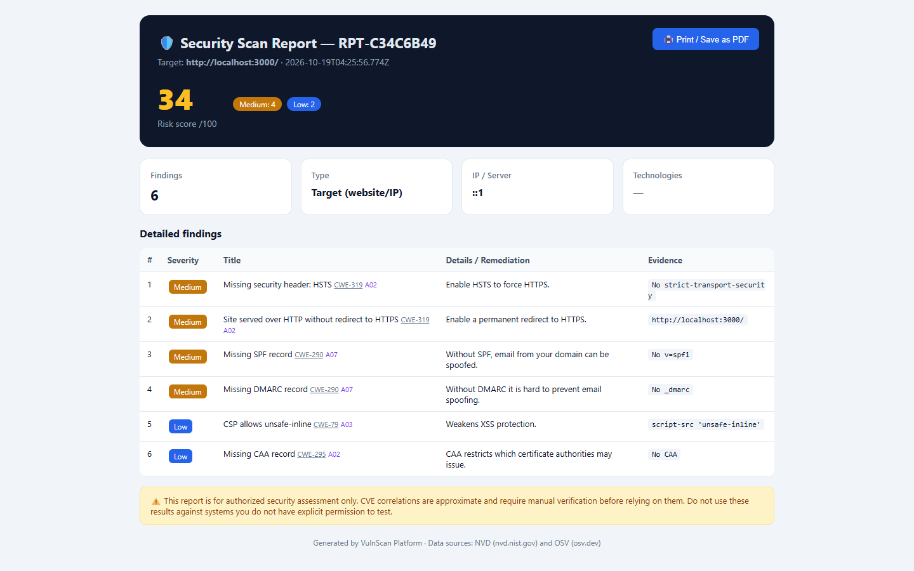
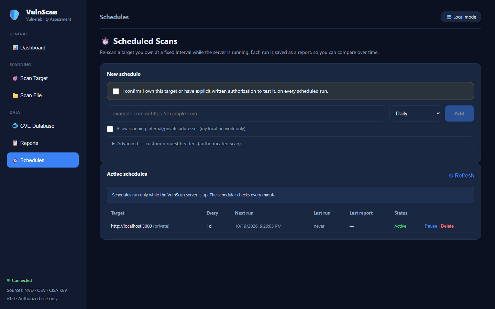

<div align="center">

# 🛡️ VulnScan

### Your own vulnerability scanner — one `npm start` away.

Scan websites, IPs, source code and dependency files against **100,000+ CVEs**, watch every check run **live**, and ship **SARIF** straight into GitHub Code Scanning.
**Self-hosted. Two dependencies. No cloud account. No data leaves your machine.**

[](https://github.com/bstforom/vulnscan/actions/workflows/ci.yml)




</div>

---

## 🤔 Why VulnScan?

Most scanners are either expensive SaaS that wants your targets on *their* servers, or a pile of CLI tools you have to glue together. VulnScan is a single, readable Node.js app you run on your own laptop or server.

| | |
|---|---|
| 🎯 **Accuracy first** | A CVE is only reported when the detected version actually falls inside the vulnerable **CPE range**. Exposed files are confirmed by **content signature**, not just `200 OK` — so catch-all pages don't flood you with false positives. |
| 👀 **Nothing is a black box** | A **live log** streams every phase as it happens: DNS, TLS, WAF detection, fingerprinting, each deep check and its result. |
| 🔥 **Prioritized by real-world risk** | Findings are ranked using **CISA KEV** (actively exploited), optional **EPSS** probability, confidence and CVSS. |
| 🔁 **Fits your pipeline** | Web dashboard, **CLI** with CI-friendly exit codes, **SARIF** for GitHub Code Scanning, and a **JS library API**. |
| ⏱️ **Set it and forget it** | **Scheduled scans** plus **history diff** show exactly which findings are new and which were fixed since the last run. |
| 🧱 **Safe by design** | Passive and light-active checks only. No exploitation, DoS, brute-force or evasion — and every scan requires an authorization acknowledgment. |

---

## 📸 Screenshots

<table>
<tr>
<td width="50%"><p align="center"><b>Dashboard</b> — CVE database, KEV count, recent reports</p></td>
<td width="50%"><p align="center"><b>Report</b> — risk score, OWASP/CWE tags, remediation, PDF export</p></td>
</tr>
<tr>
<td width="50%"><p align="center"><b>Live scan</b> — watch every check as it runs</p></td>
<td width="50%"><p align="center"><b>Schedules</b> — recurring scans of your own assets</p></td>
</tr>
</table>

---

## ⚡ Quick start

Requires **Node.js 22+** (uses the built-in `node:sqlite`; the `--experimental-sqlite` flag is already in the npm scripts).

```bash
git clone https://github.com/bstforom/vulnscan.git
cd vulnscan
npm install
npm start
```

Open **http://localhost:3000** — that's it. In local mode there is no login; the dashboard opens directly.

> The CVE database seeds itself with the latest CVEs on first run. For full coverage, build the complete database with `npm run import` (see below).

---

## ✨ Features

### 🌐 Website / IP scanning
Dozens of safe checks, each tagged with **OWASP Top 10** and **CWE**:
- **Security headers** — HSTS, CSP (incl. `unsafe-inline` / `unsafe-eval` analysis), X-Frame-Options, COOP, CORP, nosniff, Referrer- and Permissions-Policy
- **Cookies** — Secure / HttpOnly / SameSite, `__Host-` prefix, `SameSite=None` without Secure
- **TLS** — expiry, outdated protocols, weak RSA keys, self-signed certs, hostname mismatch
- **Technology & version fingerprinting** (server, framework, CMS, JS libraries) → **CVE correlation**
- **Sensitive path exposure** with content-signature confirmation — Git/SVN, `.env`, backups, DB dumps, admin panels, phpinfo, Spring Actuator, Swagger, cloud secrets…
- **CORS** misconfiguration (origin reflection, `*`, `null`, credentials) and risky **HTTP methods**
- **WAF / CDN detection** — Cloudflare, Akamai, Sucuri, Imperva, F5, ModSecurity…
- **HTML analysis** — mixed content, missing SRI, insecure forms, leaked internal IPs / emails, sensitive comments
- **DNS security** — SPF, DMARC, CAA
- **GraphQL introspection**, exposed **source maps**, lightweight **WordPress** checks

**Plus:**
- 🔑 **Authenticated scanning** — pass custom headers (`Cookie`, `Authorization`) to scan behind a login
- 📦 **Bulk scanning** — up to 20 targets in one run
- 🔎 **Subdomain discovery** via Certificate Transparency (crt.sh)
- 📈 **History diff** — compare the last two scans of a target: new vs. resolved findings

### 📁 File & code scanning
- **Dependency vulnerabilities** via [OSV.dev](https://osv.dev) — npm (`package.json`, lockfiles, yarn, pnpm), PyPI (`requirements.txt`, Pipfile, poetry), Maven, Go, crates.io, Packagist, RubyGems, NuGet, Pub, Hex
- **Secret detection** (30+ patterns) — AWS, GCP, GitHub, GitLab, Slack, Stripe, OpenAI, Anthropic, private keys, JWTs, DB connection strings… values are **masked** in output
- **SAST-lite** (35+ rules) — SQL / command / XPath injection, SSRF, path traversal, XXE, insecure deserialization, weak crypto, disabled TLS verification, `eval`, Log4Shell, SSTI, open redirect, backdoors… with line numbers
- SHA-256, file type and entropy

### 🧬 CVE intelligence
- Local **SQLite + FTS5** database that scales to **100k+ CVEs** from NVD, with instant full-text search
- **CISA KEV** flags for actively exploited vulnerabilities; optional **EPSS** scores
- **Precise CPE version-range matching** — no "nginx is mentioned in a CVE, so you're vulnerable" noise

### 📄 Reporting
- **HTML + JSON + SARIF 2.1.0** for every scan, with risk score, severity breakdown, remediation and OWASP/CWE references
- One-click **Print / Save as PDF**
- Reports are indexed in the database with pagination

### ⏱️ Scheduled scans
- Re-scan your own targets **hourly, daily, weekly** or on a custom interval (5 min – 4 weeks)
- Pause / resume / delete from the UI; each run is saved as a report and feeds the history diff

---

## 🖥️ CLI

```bash
node bin/vulnscan.js example.com                          # scan a website / IP
node bin/vulnscan.js --file package-lock.json             # scan a dependency manifest or any file
node bin/vulnscan.js example.com --sarif --html -o out/   # also write SARIF + HTML reports
node bin/vulnscan.js app.example.com -H "Cookie: session=..."   # authenticated scan
```

The CLI exits with code **1** when HIGH or CRITICAL findings are present (use `--exit-zero` to disable) — perfect for failing a CI build.

### GitHub Actions → Code Scanning

```yaml
- uses: actions/setup-node@v4
  with: { node-version: 22 }
- run: git clone --depth 1 https://github.com/bstforom/vulnscan /tmp/vulnscan && npm ci --prefix /tmp/vulnscan
- run: node /tmp/vulnscan/bin/vulnscan.js --file package-lock.json --sarif -o vulnscan-results --exit-zero
- uses: github/codeql-action/upload-sarif@v3
  with: { sarif_file: vulnscan-results }
```

## 📚 Library API

```js
import { scanTarget, scanFile, buildReport, buildSARIF } from './index.js';

const scan = await scanTarget('https://your-site.example', {
  onLog: (e) => console.log(e.phase, e.message),   // live progress events
});
const report = buildReport({ kind: 'target', scan });
console.log(report.riskScore, report.findings.length);
```

Exports: `scanTarget`, `parseTarget`, `scanFile`, `detectManifest`, `buildReport`, `renderHTML`, `buildSARIF`, `scanSecrets`, `scanCode`, `fingerprint`, `discoverSubdomains`, `compareVersions`, `versionInRange`. None of them need the SQLite database.

---

## 🗄️ Build the full CVE database (100k+)

```bash
npm run import
```

- Default target is **100,000** CVEs — change it with `TARGET=250000 node --experimental-sqlite scripts/import-cve.js`
- An **NVD API key** is strongly recommended (50 req/30 s instead of 5): `NVD_API_KEY=xxxx npm run import` — free from [nvd.nist.gov](https://nvd.nist.gov). Without a key, 100k takes ~15–25 minutes.
- Add EPSS scores: `EPSS=1 npm run import`
- The importer is **resumable** and merges the CISA KEV list automatically.

### Environment variables
| Variable | Description |
|----------|-------------|
| `PORT` | Server port (default `3000`) |
| `NVD_API_KEY` | NVD API key to raise the rate limit |
| `REQUIRE_AUTH=1` | Enable the hardened login (for shared deployments; off by default) |
| `SECURE_COOKIES=1` | `Secure` cookie flag + HSTS (only behind HTTPS) |
| `ALLOW_REGISTRATION=0` | Close registration after creating your account |
| `EPSS=1` | Import EPSS scores (with `npm run import`) |
| `VULNSCAN_DB` | Custom path for the SQLite database |

---

## 🔐 Optional hardened authentication

Local mode runs **without login**. For a shared server, enable authentication with `REQUIRE_AUTH=1`:

- **scrypt** password hashing, per-user salt, constant-time comparison
- Passwords checked against **Have I Been Pwned** using k-anonymity (the password never leaves the server)
- Strong password policy (≥ 12 chars + complexity), account lockout, per-IP rate limiting
- Random session IDs in `HttpOnly` + `SameSite=Strict` cookies, regenerated on login
- **CSRF** tokens on every state-changing request, and strict **security headers** (CSP, HSTS, X-Frame-Options…) on the platform itself

There are **no default credentials** — you create the first account yourself.

---

## 🔌 REST API

State-changing requests require the `X-CSRF-Token` header (satisfied automatically in local mode).

| Method | Path | Description |
|--------|------|-------------|
| GET | `/api/health` | Health check |
| POST | `/api/auth/register` · `/login` · `/logout` | Account management (when `REQUIRE_AUTH=1`) |
| GET | `/api/auth/me` | Current user + CSRF token |
| GET | `/api/cve/latest?limit=&q=` | Latest CVEs / full-text search |
| GET | `/api/cve/stats` | Database statistics (total, KEV, CPE) |
| POST | `/api/scan/target` | Scan a target — `{target, authorized:true, allowPrivate?, headers?}` |
| POST | `/api/scan/target/stream` | Same, streamed as NDJSON live-log events |
| POST | `/api/scan/targets` | Bulk scan — `{targets:[...], authorized:true}` (max 20) |
| POST | `/api/scan/file` | Scan a file (multipart: `file`, `authorized=true`) |
| GET | `/api/discover/subdomains?domain=` | Subdomain discovery (Certificate Transparency) |
| GET | `/api/reports?limit=&offset=` | Paginated reports |
| GET | `/api/reports/diff?subject=` | New vs. resolved findings between the last two scans |
| GET · POST | `/api/schedules` | List / create scheduled scans |
| POST | `/api/schedules/:id/toggle` | Pause or resume a schedule |
| DELETE | `/api/schedules/:id` | Delete a schedule |

---

## 📁 Project structure

```
server.js              Express server, REST API and scheduler
index.js               Public library API
bin/vulnscan.js        Command-line interface
src/scanner.js         Target-scan orchestration (+ live-log events)
src/checks.js          Headers, cookies, HTML, DNS, WAF, CORS, GraphQL, source maps, WordPress
src/wordlists.js       Sensitive paths with content signatures, WAF & JS-library signatures
src/fingerprint.js     Technology and version detection
src/cpe.js             CPE parsing and version-range comparison
src/cve.js · nvd.js    CVE retrieval, search and correlation
src/db.js              SQLite + FTS5 (CVEs, CPE, KEV, EPSS, reports, schedules)
src/fileScan.js        Dependency scanning via OSV (+ manifest parsers)
src/secrets.js         Secret detection (30+ patterns)
src/sast.js            Static analysis (35+ rules)
src/sarif.js           SARIF 2.1.0 export
src/discover.js        Subdomain discovery (crt.sh)
src/report.js          JSON / HTML / SARIF report generation
src/auth.js · security.js   Optional hardened auth, CSRF, rate limiting, security headers
scripts/import-cve.js  Bulk NVD importer (100k+, KEV, EPSS)
public/                Dashboard (vanilla HTML/CSS/JS — no build step)
test/                  Test suite (node:test)
```

```bash
npm test     # 45 tests, built-in Node test runner
```

---

## ⚖️ Responsible use

> ⚠️ **Only scan systems you own or have explicit written permission to test.** Unauthorized scanning of third-party systems is illegal in most jurisdictions.

- VulnScan is **passive and non-aggressive** — no exploitation, denial-of-service, brute-force or detection evasion, and pull requests adding such features will be declined.
- No passive scanner finds **every** vulnerability; business-logic and access-control flaws need authorized manual testing.
- CVE correlations are **best-effort** — verify before you act on them.
- Data sources: [NVD](https://nvd.nist.gov), [OSV](https://osv.dev), [CISA KEV](https://www.cisa.gov/known-exploited-vulnerabilities-catalog), [FIRST EPSS](https://www.first.org/epss), [crt.sh](https://crt.sh).

**You are solely responsible for how you use this tool.**

---

## 🤝 Contributing

Contributions are welcome — new checks, parsers, SAST rules, and false-positive fixes especially. See [CONTRIBUTING.md](CONTRIBUTING.md).

Found a security issue **in VulnScan itself**? Please report it privately — see [SECURITY.md](SECURITY.md).

## 👤 Maintainer

Built and maintained by **Ahmed AL Abri** — a.ghost.om@gmail.com · 79033079a@gmail.com

If VulnScan helps you, a ⭐ on the repo helps others find it.

## 📜 License

[MIT](LICENSE) © 2026 Ahmed AL Abri
